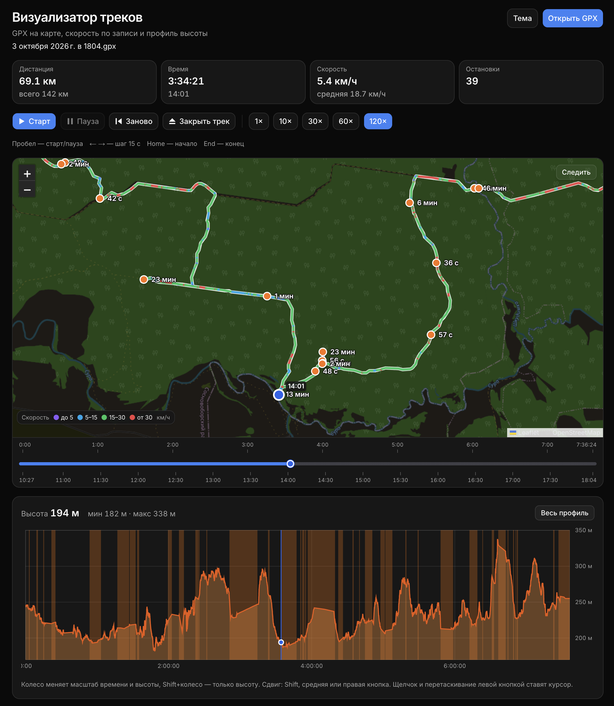

# GPX web player — интерактивный визуализатор треков

Веб-приложение для просмотра GPX треков. Откройте файл записи — маршрут появится на карте OpenStreetMap, его можно воспроизвести по меткам времени и посмотреть профиль высоты. Своих точек приложение не подставляет: пока файл не выбран, трека на экране нет.

A local GPX track viewer. Open a recording to replay it on OpenStreetMap by GPS time, with a speed-colored route, stops, and an elevation profile. The file stays in your browser.



*Карта, шкала времени и профиль высоты.*

Скорость на экране — это расстояние между точками GPX, делённое на паузу между их метками времени. Она не зависит от скорости воспроизведения. Линия маршрута красится по этой скорости: до 5, 5–15, 15–30 и от 30 км/ч. Легенда цветов лежит в левом нижнем углу карты.

Остановки — участки не короче 30 секунд в пределах примерно 40 метров со средней скоростью не выше 2,2 км/ч. Близкие остановки (до 70 метров и двух минут) склеиваются в одну метку. При воспроизведении остановка длиннее 3 минут занимает около 2 секунд реального времени: курсор стоит на ней, затем перескакивает к отправлению. Остановки до 3 минут идут с выбранной скоростью воспроизведения. Ручная перемотка по-прежнему может остановиться внутри долгой стоянки.

Профиль высоты строится только по меткам `ele`. Если их нет, график не рисуется.

## Запуск

Нужен Node.js 20.9 или новее. Без меток времени в точках GPX маршрут не воспроизводится.

```bash
npm install
npm run dev
```

Откройте адрес, который покажет Next.js. Тайлы карты загружаются с серверов OpenStreetMap, поэтому нужен доступ в интернет.

## Просмотр

### Файл

Последний открытый GPX сохраняется в браузере и поднимается после перезагрузки. Имя файла видно под заголовком. «Закрыть трек» останавливает воспроизведение, убирает маршрут с экрана и стирает сохранённую копию.

Сам файл остаётся в браузере. На сервер уходят только тайлы карты OpenStreetMap.

### Тема

Кнопка «Тема» переключает светлое оформление, тёмное и вариант «Как в системе». Выбор запоминается. В тёмной теме тайлы карты инвертируются, синий цвет маршрута и кнопок остаётся.

### Время

Карточка «Время» показывает прошедшее время от начала записи и местное время текущей GPS-метки. Те же часы написаны рядом с курсором на карте. Если запись переходит через полночь, у отметок следующего дня есть дата.

Над линейкой времени — шкала от 0:00 до конца записи. Под ней — местное время GPS-меток. Сдвиг линейки или щелчок по профилю высоты сразу ставит курсор в центр карты на текущем масштабе, без медленного следования.

Скорость воспроизведения: 1×, 10×, 30×, 60× и 120×. По умолчанию включено 120×.

### Клавиши

Под кнопками воспроизведения есть легенда клавиш. Пробел запускает и ставит на паузу, стрелки влево и вправо сдвигают курсор на 15 секунд записи, Home и End переходят к началу и концу. Клавиши не перехватываются, пока фокус в поле ввода.

### Карта

Кнопка «Следить» включает и выключает удержание курсора в центре. Его также выключают перетаскивание карты и кнопки масштаба. На паузе и на остановке карта не приближается так же сильно, как при медленной езде. При быстром воспроизведении она заранее отдаляется, чтобы курсор оставался в кадре.

### Остановки

Под графиком высоты — список остановок: номер, местное время и длительность. Клик по строке или по метке остановки на карте перематывает курсор к началу этой стоянки и центрирует карту. Текущая остановка в списке подсвечена.

### Профиль

Колесо на профиле меняет масштаб времени и высоты вместе, Shift+колесо — только высоту. Сдвиг графика: Shift, средняя или правая кнопка мыши. Кнопка «Весь профиль» возвращает весь маршрут.

## Лицензия

Проект распространяется по лицензии [MIT](LICENSE).
